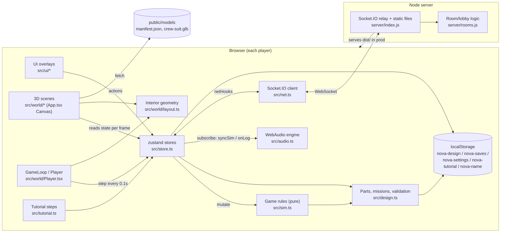

# NOVA SHIFT — Architecture Overview

_Written from a read-only review of the source on 2026-11-15. Claims cite the files they come from; places I did not read closely are marked as such._

## 1. Summary
- NOVA SHIFT is a browser 3D game for 1 to 4 co-op players (`README.md`).
- Players build a spacecraft in a Shipyard within a budget, mass limit and required-parts rules (`src/design.ts`). Then they walk around inside it in first person and keep power, comms and science running for a 10-minute mission (`src/sim.ts`, `MISSION_SECONDS = 600`).
- It's a single TypeScript/React app (Vite, React Three Fiber, zustand) plus a small Node Socket.IO server (`server/`).
- In multiplayer the **host's browser runs the game rules**. The server only manages lobbies and relays messages (`server/index.js`).
- There is no database. All saves live in the browser's localStorage (`src/design.ts`, `src/store.ts`).
- All 3D models and sounds are generated in code. Optional `.glb` files can replace the built-in models (`src/world/parts/assets.tsx`, `src/audio.ts`).
- It deploys as one Node web service on Render, which serves both the built game and the WebSocket server (`render.yaml`, `server/index.js`).

## 2. Stack and entry points
| Item | Detail | Source |
|---|---|---|
| Languages | TypeScript (client, test scripts), JavaScript ESM (server) | `package.json` (`"type": "module"`) |
| Client | React 18, @react-three/fiber, drei, postprocessing, three 0.169, zustand 4, lucide-react | `package.json` |
| Server | Node `http` + socket.io 4 | `server/index.js` |
| Build | Vite 5 (`@vitejs/plugin-react`) | `vite.config.ts` |
| Browser entry | `index.html` → `src/main.tsx` → `<CrashGuard><App/></CrashGuard>` | |
| Server entry | `server/index.js` (port `PORT`, default 3001) | |
| Dev entry | `scripts/dev.mjs` runs the server and Vite together | |
| Install hook | `scripts/copy-draco.mjs` copies the Draco decoder into `public/draco` | `package.json` postinstall/predev/prebuild |

## 3. Component diagram

## 4. Modules
| Module | Purpose | Key files | Depends on |
|---|---|---|---|
| Game rules | Pure functions over `GameState`: power routing, generator, battery, antenna, instruments, random events, objectives, scoring (`finish`), next-step hints (`nextGoal`). No React. | `src/sim.ts` | `design.ts` |
| Ship design | Parts catalog, 3 missions (echo/survey/relay) with budgets and required parts, `computeStats`, `validate` checks, save/load. | `src/design.ts` | localStorage |
| State store | zustand stores for UI, settings, design, shipyard, saves, network and game. `act()` checks roles and either applies an action or sends it to the host. `mutate()` clones the state and applies a sim function. | `src/store.ts` | `sim`, `design`, `audio`/`sfx` |
| Networking (client) | Socket.IO connection, room create/join/start, applies host state on clients, stores remote positions, fills `netHooks`. | `src/net.ts` | `store` |
| Server | Lobby and room rules (4-letter code, 4 roles, ready check, host leaving closes the room) kept separate from networking. Relays actions, state and positions. Serves `dist/` in production. | `server/rooms.js`, `server/index.js` | socket.io |
| App shell | One R3F `<Canvas>` that switches scenes by `useUI.screen`, HTML overlays, optional bloom, an audio unlock on first input, and crash and error screens. | `src/App.tsx`, `src/main.tsx`, `src/CrashGuard.tsx` | everything in the UI and world |
| World / interior | First-person movement and collision, finding nearby consoles, a fixed 0.1 s game loop, interpolated remote players, the ship interior with live screens, the shipyard and menu scenes. | `src/world/Player.tsx`, `Ship.tsx` (923 lines), `interior/Rooms.tsx` (839), `layout.ts`, `ShipyardScene.tsx`, `MenuScene.tsx` | `store`, `layout`, `audio` |
| Part models | Procedural models for each part, with optional GLB overrides from `public/models/manifest.json`. | `src/world/parts/*` | drei `useGLTF` |
| UI overlays | Menus, lobby, shipyard dashboard, HUD, the 5 console panels (power, comms, science, command, engine), briefing and debrief, settings, toast, tutorial card. | `src/ui/*` | `store`, `net`, `design`, `sfx` |
| Audio | Generated ambient hum, per-room sound, 3D-positioned sound effects and alarms that react to sim changes. | `src/audio.ts` (697 lines), `src/sfx.ts` (re-export shim) | Web Audio API, `sim` |
| Tutorial | 7 guided steps whose `done(state, ui)` checks move the tutorial forward. Can force events (`forceEvent`). | `src/tutorial.ts`, `src/ui/TutorialCard.tsx` | `store`, `sim` |
| Tests | Node scripts that print PASS/FAIL. | `scripts/sim-test.ts`, `rooms-test.js`, `layout-test.ts`, `audio-test.ts` | the modules they test |

## 5. Key flows

### A. Solo: design → launch → play → debrief
1. Main menu NEW MISSION sets `screen: 'shipyard'`, `shipyardFor: 'mission'` (`src/ui/MainMenu.tsx:24`).
2. Shipyard edits call `setPart`, `attachPart` and similar → `putDesign()`, which saves `nova-design` and updates `useDesign` (`src/store.ts`). The dashboard uses `computeStats` and `validate` (`src/design.ts`).
3. LAUNCH only works when `valid`. It then moves to `screen: 'briefing'` (`src/ui/Shipyard.tsx:100-104`).
4. BEGIN MISSION → `launch('mission')` → `mutate(g => sim.startMission(g, rand, design))` and `screen: 'game'` (`src/ui/Screens.tsx:46`, `src/store.ts`).
5. Every frame, `GameLoop` builds up time and calls `useGame.step(0.1)` → `sim.tick` (`src/world/Player.tsx`). In solo the loop pauses when the mouse is unlocked and no panel is open.
6. Pressing E at a console opens a panel. Its buttons call store actions → `act()` → `mutate(LOCAL[name])`.
7. `App.tsx` subscribes to `useGame`, which drives `syncSim` and `onLog` in audio. The 3D screens read `useGame.getState()` every frame (`Ship.tsx`).
8. `sim.finish` sets `phase` to won or lost and fills in `result` with a score and grade. The debrief screen shows it (`src/sim.ts:552+`).

### B. Multiplayer: lobby → start → host-run sim
1. Host: `createRoom` → `room:create` → `Rooms.create` (host = commander, ready) → `room:update` broadcast (`src/net.ts`, `server/index.js`, `server/rooms.js`).
2. Guests: `joinRoom(code)` → `Rooms.join`, which gives them a free role. Guests can then change role and press ready.
3. Host START → `room:start` with the host's `design`. The server checks that everyone is ready, then sends `game:start {design}` to everyone, and each client calls `launch('mission', design)`.
4. During play:
   - **Host** runs `GameLoop` and, after each step, calls `netHooks.sendState(cloneData(state))`. The server forwards this as `game:state` to the others, and each client calls `useGame.setState(state)`.
   - **Client** actions take the `act()` path → `game:action` → the server forwards them to the host only → `applyRemoteAction` checks the role again with `allowed()` and applies the action.
   - Positions are sent every 0.1 s as `player:pos`. The server cleans the numbers and sets `id` itself, then forwards them. Clients write them into `useNet.remote` without triggering a React render.
   - If the host's tab is hidden, a 250 ms timer calls `hostCatchUp()` so the sim keeps running (`Player.tsx`, `store.ts`).
5. Disconnects: if the host leaves, the server sends `room:closed` and clients go back to the menu. There is no reconnect (`reconnection: false`).

### C. Role-gated action (example: transmit)
The comms panel calls `toggleTransmit()` → `act('toggleTransmit')` → `rolesFor` gives `['comms']` → `allowed()` passes if the player is comms or **no one holds comms**. Otherwise the player sees a toast saying "Only the COMMUNICATIONS OFFICER…". Then:
- solo or host: `sim.toggleTransmit`
- client: send to the host, which checks `allowed` again (`src/store.ts`).

## 6. Data and integrations
- **Game state:** `GameState` in `src/sim.ts` (about 50 fields: power, antenna, instruments, data, battery, events, objectives, a log capped at 40 entries, result). It lives only in memory in the zustand `useGame` store, and the host owns it.
- **Design:** `Design` and `Stats` in `src/design.ts`. The current design is stored as `nova-design`, and up to 8 named saves as `nova-saves`.
- **Other localStorage keys:** `nova-settings`, `nova-tutorial`, `nova-name` (`store.ts`, `Lobby.tsx`).
- **Server memory:** a `Map` of rooms and a `Map` from player to room (`server/rooms.js`). Nothing is saved on the server.
- **Static assets:** `public/models/manifest.json` (currently `{}`), `crew-suit.glb`, and `public/draco` (copied in at install).
- **External services:** none of the game logic calls outside services. In dev the client connects to `hostname:3001`, and in production to the same origin (`net.ts`). The one outside dependency is the Draco decoder: `src/world/SuitModel.tsx` sends a HEAD request for `draco/draco_decoder.wasm` and uses the local copy if it's there. Otherwise it falls back to drei's default decoder path, which I understand to be a Google-hosted CDN (I didn't confirm this in `node_modules`, which isn't installed). Only the optional crew suit model needs it.

## 7. Operations
- **Build/deploy:** Render free plan: `npm install --include=dev && npm run build`, then `npm start` (`render.yaml`). There is no Docker and no CI config (no `.github/`).
- **Tests:** `npm run test:sim`, `test:rooms`, `test:layout` (Node `--experimental-strip-types`), and `npx tsx scripts/audio-test.ts`. They are not wired into any pipeline.
- **Config:** only `PORT` (`server/index.js`). There are no secrets and no `.env`.
- **Logging:** `console.error` on the server. Every socket handler is wrapped in try/catch, and there are global `uncaughtException`/`unhandledRejection` handlers so one bad message can't crash the server.
- **Client errors:** `CrashGuard` catches errors during rendering and shows a crash screen. `ErrorBanner` shows window errors and rejected promises. Losing the WebGL context shows a toast (`App.tsx`). Optional models are wrapped in `Safe` and `Suspense` fallbacks.

## 8. Risks and problems
1. **No CI and no type-check script.** `tsconfig` has `strict: false`, and nothing runs the tests automatically.
2. **`tsx` isn't a dependency.** `audio-test.ts` relies on `npx` downloading it.
3. **The full state is broadcast about 10 times a second.** The host deep-clones the whole `GameState` (`structuredClone` for each key, `sim.cloneData`) after every step and sends it, including the log and the design. `mutate()` also clones on every step. This is fine for 4 players, but bandwidth and GC cost grow with the state. I didn't measure it.
4. **The server trusts the host completely.** `game:state` and the `room:start` design are relayed without checks, and `net.ts` calls `useGame.setState(state)` directly. This is acceptable for co-op with friends, but a modified host client could send anything.
5. **Single point of failure.** If the host leaves or disconnects, the room closes, and there's no reconnect or host migration.
6. **Large files.** `Ship.tsx` (923 lines), `interior/Rooms.tsx` (839) and `audio.ts` (697) are the hardest to change. I didn't review them in detail.
7. **Coupling through the store.** `store.ts` imports `audio`/`sfx`, so the game rules layer can't be loaded in Node without the audio layer. The tests avoid this by importing `sim.ts` directly. `tutorial.ts` and `store.ts` import each other (tutorial → store, store → `putDesign` logic for tutorial mode).
8. **Small inconsistencies and leftover code:**
   - `OBJECTIVE_TEXT` in `sim.ts` isn't used anywhere (it was replaced by `objectiveTexts(missionId)`).
   - `src/sfx.ts` only exists to keep an old import path working.
   - `MainMenu.tsx:50` writes `nova-tutorial` itself instead of calling `markTutorialDone()`.
   - `Lobby.tsx:19` reads localStorage without try/catch, unlike everywhere else.
9. **Production only.** The server's path check is `file.startsWith(DIST)`, a simple prefix check. CORS is `*`. Low risk, since the server only serves static files.
10. **Missing tests:** UI, the store's role gating (`allowed`, `rolesFor`, `act`, `applyRemoteAction`) and the `net.ts` message flow have no tests. `scripts/sim-test.ts` (42 checks) does cover design validation, including survey budgets and required instruments and relay antenna rules (lines 83-113).

## 9. Open questions for the team
1. Is host-authoritative state sync the long-term model, or is a server-run sim planned (for anti-cheat or reconnect)?
2. Should players be able to reconnect or take over as host, or is "room closes" the intended behavior?
3. Is Render's free plan the real target (cold starts are already mentioned in the `net.ts` error text)? Is there a plan for CI that runs the tests before deploy?
4. Are the `.glb` override manifest and the crew suit still being developed, or are they optional extras?
5. Is `strict: false` intentional, or is turning on strict typing planned?
6. Is it OK that the crew suit falls back to an online Draco decoder when `public/draco` is missing (for example, if `postinstall` was skipped)?
7. Should role gating (`allowed`/`rolesFor` in `src/store.ts`) move into a module with no React dependency so it can be tested like `sim.ts`?
